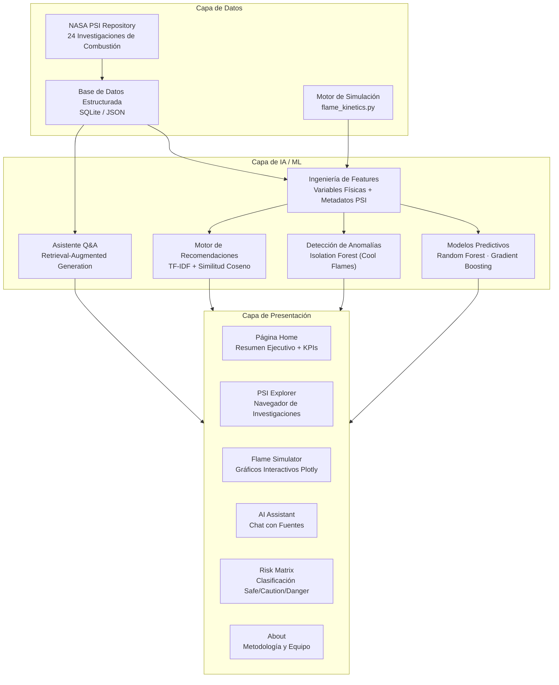
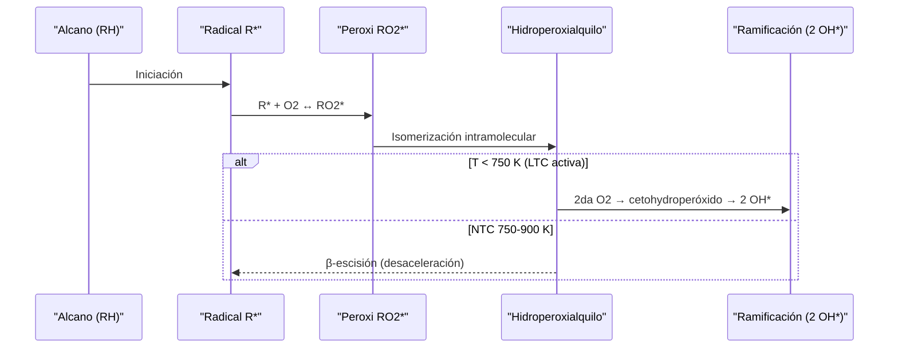
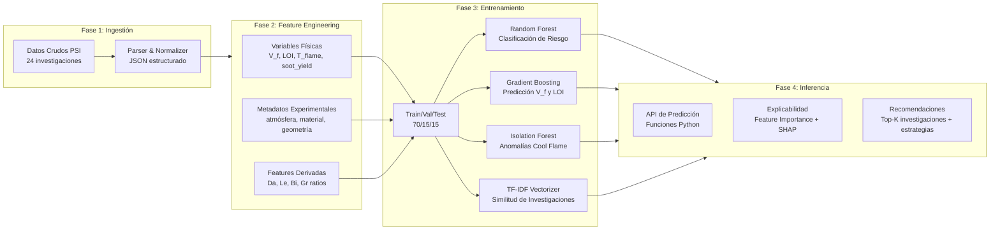
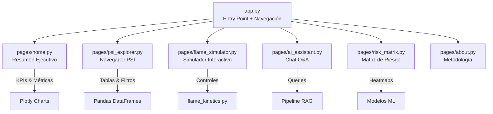
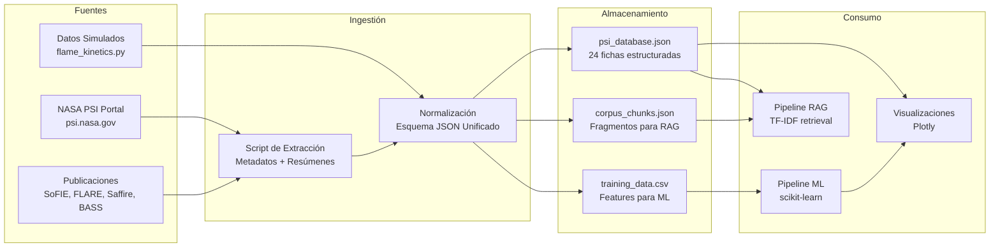

# 🔥 Plan de Implementación: "Flame in Freefall"
## Dashboard Interactivo con IA para Seguridad contra Incendios en Microgravedad
### NASA Space Apps Challenge 2026 — PSI Data-Driven Fire Safety

---

## 1. Resumen Ejecutivo

**Flame in Freefall** es un **dashboard web interactivo potenciado por IA** que consume los datos del repositorio **NASA PSI** (Physical Sciences Informatics — 24 investigaciones de combustión, ~12 TB) para **identificar, extraer, clasificar e interpretar** hallazgos de combustión en microgravedad, y traducirlos en **recomendaciones accionables** para sistemas de supresión, protocolos de seguridad y aplicaciones de seguridad contra incendios terrestres.

### Lo que entrega el proyecto

| Componente | Descripción |
|:---|:---|
| **Dashboard Streamlit** | Interfaz multi-página con tema aeroespacial oscuro, gráficos interactivos Plotly y simulador de llamas |
| **Motor de Simulación Física** | `flame_kinetics.py` — predicción de $V_f$, LOI shift, transientes de llamas frías |
| **Pipeline de ML** | Modelos scikit-learn para clasificación de riesgo, detección de anomalías y recomendaciones |
| **Asistente IA (Q&A)** | Sistema RAG con atribución de fuentes NASA para consultas en lenguaje natural |
| **Base de Conocimiento** | Corpus estructurado de 24 investigaciones PSI + física de combustión en micro-g |

> [!IMPORTANT]
> El entregable principal NO es un paper ni un diseño mecatrónico, sino un **producto de software funcional** que demuestre cómo la IA y los datos PSI mejoran la seguridad contra incendios espaciales y terrestres.

---

## 2. Arquitectura General del Sistema



---

## 3. Base de Conocimiento: Física de la Combustión en Microgravedad

> [!NOTE]
> Esta sección documenta la ciencia que **alimenta los modelos de IA y el corpus del asistente Q&A**. No es el entregable final, sino el conocimiento que lo hace posible.

### 3.1 Ecuaciones de Gobierno

En caída libre ($g \to 0$), el término de flotabilidad desaparece y el transporte se vuelve puramente difusivo:

**Continuidad:**
$$\frac{\partial \rho}{\partial t} + \nabla \cdot (\rho \mathbf{u}) = 0$$

**Cantidad de Movimiento** (sin flotabilidad):
$$\rho \left( \frac{\partial \mathbf{u}}{\partial t} + \mathbf{u} \cdot \nabla \mathbf{u} \right) = -\nabla p + \nabla \cdot \boldsymbol{\tau} + \cancel{\rho \mathbf{g}}$$

**Conservación de Especies** ($k = 1, \dots, N_s$):
$$\rho \left( \frac{\partial Y_k}{\partial t} + \mathbf{u} \cdot \nabla Y_k \right) = -\nabla \cdot \mathbf{j}_k + \dot{\omega}_k M_k$$

donde $\mathbf{j}_k = -\rho D_{k,m} \nabla Y_k - D_k^T \frac{\nabla T}{T}$ incluye difusión de Fick y efecto Soret.

**Energía Térmica:**
$$\rho c_p \left( \frac{\partial T}{\partial t} + \mathbf{u} \cdot \nabla T \right) = \nabla \cdot (\lambda \nabla T) - \sum_{k=1}^{N_s} h_k \dot{\omega}_k M_k - \nabla \cdot \mathbf{q}_{\text{rad}}$$

con $\nabla \cdot \mathbf{q}_{\text{rad}} = 4 \kappa_P \sigma (T^4 - T_\infty^4)$ (medio ópticamente delgado).

### 3.2 Envolturas de Hollín (Soot Shells)

Sin convección, las partículas de hollín quedan atrapadas donde se anula la velocidad neta radial:

$$v_{p,r}(r) = u_r(r) + v_{\text{th},r}(r) = 0$$

La velocidad termoforética:
$$v_{\text{th}} = - \frac{C_{\text{th}} \nu}{T} \nabla T, \quad C_{\text{th}} \approx 0.55$$

Resultado: una envoltura densa de hollín que maximiza la emisión IR, fuerza la extinción radiativa prematura y desencadena la transición a **llamas frías**.

### 3.3 Cinética de Baja Temperatura (LTC) y Llamas Frías



Características críticas para la IA:
- **Invisibilidad óptica** → los detectores convencionales fallan
- **Subproductos tóxicos** ($CO$, $CH_2O$, $H_2O_2$) → señales para detección ML
- **Persistencia decenas de segundos** → ventana de reencendido catastrófico

### 3.4 Paradoja 1-g vs Micro-g (NASA-STD-6001B)

El estándar terrestre produce **falsos positivos de seguridad**: materiales que pasan el test en 1-g pueden propagar llama autososteniada en micro-g con flujos HVAC de $0.4$–$5\text{ cm/s}$, alcanzando $LOI_{\text{orbital}} < LOI_{\text{terrestre}}$.

### 3.5 Detección Brunswick/MPASS y Espectroscopía TDLAS

Movilidad eléctrica para nanopartículas de $10$–$100\text{ nm}$:
$$Z_p = \frac{n e C_c(d_p)}{3 \pi \mu d_p}$$

Canales TDLAS: $H_2O_2$ (7.5 μm), $CH_2O$ (3.6 μm), $CO$ (4.6 μm).

### 3.6 Supresión Limpia: Niebla NFPA 750 + F-500 EA

Tasa de agua requerida para extinguir una llama de $\dot{Q} = 5\text{ kW}$:
$$\dot{m}_{\text{water}} = \frac{\dot{Q}}{\Delta h_{\text{sens}} + \Delta h_{\text{vap}}} = \frac{5}{2591.7} \approx 1.93\text{ g/s}$$

150 ml de niebla atomizada ($D_{v0.50} = 35\text{ μm}$) durante 60 s extinguen la llama sin sobrepresurizar la cabina.

---

## 4. Arquitectura de IA / ML

### 4.1 Visión General del Pipeline



### 4.2 Modelos Implementados

#### 4.2.1 Predicción de Propagación de Llama (Physics-Informed ML)

- **Modelo:** Gradient Boosting Regressor (scikit-learn)
- **Entradas:** velocidad de flujo $V_g$, diámetro de combustible $d$, concentración de $O_2$, presión, tipo de material
- **Salida:** $V_f$ predicho (mm/s) y $\Delta LOI = LOI_{1g} - LOI_{\mu g}$
- **Validación:** contra curvas del motor `flame_kinetics.py` y datos BASS-II/FLARE publicados
- **Ventaja:** captura la relación no-monótona $V_f$ vs $V_g$ que los modelos lineales pierden

#### 4.2.2 Detección de Anomalías: Cool Flames

- **Modelo:** Isolation Forest (scikit-learn)
- **Features:** temperatura, concentraciones de $H_2O_2$, $CH_2O$, $CO$, gradiente temporal de $T$
- **Propósito:** identificar transiciones a régimen de llama fría en datos de transiente simulados
- **Umbral:** `contamination=0.08` (8% de puntos anómalos esperados)

#### 4.2.3 Clasificación de Riesgo

- **Modelo:** Random Forest Classifier
- **Clases:** `Safe` (verde), `Caution` (amarillo), `Danger` (rojo)
- **Features:** LOI del material, $V_f$ a condiciones nominales, presencia de llama fría, geometría (Bi < 0.1)
- **Explicabilidad:** Feature importance nativa + gráficos de barras por clase

#### 4.2.4 Motor de Recomendaciones

- **Técnica:** TF-IDF sobre descripciones de investigaciones PSI + similitud coseno
- **Funciones:**
  1. Dado un material/escenario → recomendar las investigaciones PSI más relevantes
  2. Dado un perfil de riesgo → sugerir configuración de detección (Brunswick vs TDLAS) y estrategia de supresión
  3. Dado un hallazgo → encontrar investigaciones con hallazgos análogos

#### 4.2.5 Asistente Q&A (RAG-Style)

- **Arquitectura:** Retrieval-Augmented Generation simplificado
- **Corpus:** fichas estructuradas de 24 investigaciones PSI + secciones de la base de conocimiento (§3)
- **Retrieval:** TF-IDF / CountVectorizer sobre chunks del corpus → Top-5 fragmentos
- **Generación:** Plantillas de respuesta con interpolación de datos extraídos
- **Atribución:** cada respuesta cita la fuente NASA (nombre del experimento, DOI si disponible)
- **Fallback:** si la confianza de similitud < 0.15, responde "No tengo información suficiente en mis fuentes"

### 4.3 ¿Por Qué Este Enfoque Funciona para un Hackathon?

| Criterio | Decisión | Justificación |
|:---|:---|:---|
| Framework ML | scikit-learn | Sin GPU, instalación trivial, modelos interpretables |
| Vectorización | TF-IDF nativo | Cero dependencias pesadas, suficiente para 24 documentos |
| Explicabilidad | Feature importance | Usuarios no-ML entienden "el LOI es el factor #1" |
| Datos | Simulados + PSI metadata | 12 TB de datos PSI crudos se resumen en fichas estructuradas |
| Infraestructura | Todo local | `pip install` y `streamlit run` — sin API keys, sin cloud |

---

## 5. ¿Puede la IA/ML Hacer Esta Solución Mejor? — SÍ

### 5.1 Implementación Actual (Hackathon MVP)

- **Modelos ensemble** (Random Forest, Gradient Boosting) entrenados sobre datos del motor de simulación
- **TF-IDF + similitud coseno** para búsqueda semántica sobre el corpus PSI
- **Reglas basadas en umbrales físicos** para clasificación de riesgo
- **Isolation Forest** para detección de anomalías en transientes térmicos

### 5.2 Mejoras a Corto Plazo

- **Sentence-Transformers** (`all-MiniLM-L6-v2`) para embeddings semánticos en el Q&A
- **SHAP (SHapley Additive exPlanations)** para explicabilidad modelo-agnóstica
- **Cross-validation temporal** para validar estabilidad de predicciones en diferentes regímenes

### 5.3 Visión de Futuro

- **LLM fine-tuned** sobre el corpus NASA de combustión para Q&A conversacional avanzado
- **API real del PSI** para ingestión automática de nuevos datasets
- **Computer Vision** para clasificación de imágenes de llama (hot vs cool vs soot-dominated)
- **Reinforcement Learning** para optimización de estrategia de supresión (timing, presión, dosificación)

### 5.4 Tabla Comparativa de Enfoques

| Capacidad | Basado en Reglas | ML Clásico (actual) | Deep Learning (futuro) |
|:---|:---|:---|:---|
| Clasificación de riesgo | Umbrales fijos de LOI | Random Forest adaptativo | CNN sobre imágenes de llama |
| Búsqueda en PSI | Keyword matching | TF-IDF + coseno | Sentence-BERT + re-ranking |
| Predicción $V_f$ | Ecuación analítica | Gradient Boosting | PINN (Physics-Informed NN) |
| Detección cool flames | Umbral de $T < 800K$ | Isolation Forest | Autoencoder temporal (LSTM) |
| Q&A sobre datos | Tabla de lookup | RAG con plantillas | LLM fine-tuned + RAG |
| Recomendación | Tabla estática | Similitud coseno | Graph Neural Network |
| **Escalabilidad** | ❌ Rígido | ✅ Moderada | ✅✅ Alta |
| **Interpretabilidad** | ✅✅ Total | ✅ Feature importance | ⚠️ Requiere XAI |
| **Requisitos HW** | CPU | CPU | GPU recomendada |

---

## 6. Dashboard UI/UX

### 6.1 Arquitectura Streamlit Multi-Página



### 6.2 Tema Visual: Aerospace Dark

| Elemento | Especificación |
|:---|:---|
| **Fondo principal** | `#0a0e1a` (deep space navy) |
| **Fondo de tarjetas** | `#111827` con borde `#1e3a5f` |
| **Acento primario** | `#00d4ff` (cyan ISS telemetry) |
| **Acento de alerta** | `#ff4444` (danger), `#ffaa00` (caution), `#00cc66` (safe) |
| **Tipografía** | `Inter` para texto, `JetBrains Mono` para datos numéricos |
| **Gráficos Plotly** | Template `plotly_dark`, palette personalizada |
| **Iconografía** | Emojis temáticos (🔥 🛸 🧪 🤖 ⚠️) como delimitadores visuales |

### 6.3 Desglose Página por Página

#### 🏠 Home — Panel de Control

- KPIs: total de investigaciones PSI analizadas, materiales evaluados, alertas activas
- Gráfico de dona: distribución de riesgo (Safe/Caution/Danger)
- Timeline interactivo: hitos de investigaciones PSI (FLARE, SoFIE, Saffire, BASS-II)
- Texto de bienvenida con contexto del reto

#### 🔬 PSI Explorer — Navegador de Investigaciones

- Tabla filtrable de las 24 investigaciones de combustión del PSI
- Columnas: nombre, año, tipo de combustible, atmósfera, hallazgo clave, relevancia para seguridad
- Detalle expandible por investigación con resumen, datos clave y link a fuente NASA
- Filtros: por tipo de material, rango de fechas, régimen de gravedad

#### 🔥 Flame Simulator — Simulador Interactivo

- Sliders: $V_g$ (0–20 cm/s), $d_{\text{fuel}}$ (0.5–10 mm), $O_2$ (16–40%), presión, material
- Gráfico Plotly de $V_f$ vs $V_g$ en tiempo real (alimentado por `flame_kinetics.py`)
- Visualización de transiente de llama fría ($T$, $H_2O_2$, $CH_2O$, $CO$ vs tiempo)
- Comparación lado a lado: 1-g vs micro-g
- Selector de atmósfera (ISS / Artemis / Lunar)

#### 🤖 AI Assistant — Chat Q&A

- Input de texto para preguntas en español
- Respuestas con citas a fuentes PSI específicas
- Preguntas sugeridas: "¿Qué investigación estudia llamas frías?", "¿Cómo afecta el diámetro del cable al LOI?"
- Historial de conversación dentro de la sesión
- Indicador de confianza por respuesta

#### ⚠️ Risk Matrix — Matriz de Riesgo

- Heatmap: materiales vs condiciones atmosféricas → clasificación Safe/Caution/Danger
- Feature importance: ¿qué variable domina la clasificación?
- Detalle por celda: LOI predicho, $V_f$ estimado, recomendación de detección/supresión
- Exportar resultados como tabla

#### ℹ️ About — Metodología y Equipo

- Descripción del enfoque AI/ML
- Diagrama de arquitectura del sistema
- Créditos del equipo
- Referencias bibliográficas y links a NASA PSI

### 6.4 Accesibilidad y Usabilidad

- **Usuarios objetivo:** astronautas, ingenieros de seguridad, planificadores de misión
- **Principio:** cada página debe ser comprensible sin leer documentación previa
- **Tooltips:** cada gráfico tiene explicación en hover
- **Idioma:** español como idioma principal (el equipo es hispanohablante), con terminología técnica en inglés cuando es estándar NASA
- **Responsividad:** Streamlit se adapta a pantallas de escritorio; no se requiere mobile para el hackathon

---

## 7. Aplicaciones Terrestres de Seguridad contra Incendios

La IA y los datos PSI no solo sirven para el espacio. Las aplicaciones terrestres incluyen:

| Dominio Terrestre | Insight de Micro-g Aplicable | Aplicación Concreta |
|:---|:---|:---|
| **Incendios en aeronaves** | Flujos bajos en cabina → propagación silenciosa | Mejores materiales en fuselaje y cableado |
| **Submarinos y bunkers** | Atmósferas confinadas con O₂ enriquecido | Protocolos de detección incipiente |
| **Almacenes y data centers** | Detección de pre-pirólisis en cableado fino | Sensores de nanopartículas (10–100 nm) |
| **Industria petroquímica** | Fenómenos de llama fría y NTC | Detección de reacciones invisibles |
| **Bomberos** | Modelos de LOI bajo distintas condiciones | Predicción de propagación en materiales nuevos |
| **Normativa NFPA** | Datos de micro-g revelan brechas en tests 1-g | Actualización de estándares de certificación |

---

## 8. Pipeline de Datos: Del PSI al Dashboard



---

## 9. Roadmap de Implementación en 5 Fases

### Fase 1 — Ingestión de Datos y Estructuración del PSI (Días 1–2)

| Tarea | Entregable |
|:---|:---|
| Investigar y catalogar las 24 investigaciones de combustión del PSI | `psi_database.json` con metadatos completos |
| Extraer hallazgos clave de SoFIE, FLARE, Saffire, BASS-II, SAME | Fichas técnicas por investigación |
| Diseñar esquema JSON unificado | Esquema documentado |
| Crear script de ingestión y normalización | `data/ingest_psi.py` |
| Generar corpus de texto para RAG | `data/corpus_chunks.json` |

### Fase 2 — Motor de Simulación y Modelos Físicos (Días 2–3)

| Tarea | Entregable |
|:---|:---|
| Refinar `flame_kinetics.py` con datos PSI reales | Motor calibrado |
| Implementar curvas $V_f$ vs $V_g$ para múltiples materiales y atmósferas | Funciones validadas |
| Implementar simulación de transiente de llama fría | `simulate_cool_flame_transient()` |
| Generar dataset de entrenamiento con barridos paramétricos | `data/training_data.csv` |
| Validar contra datos publicados BASS-II y FLARE | Tabla de comparación |

### Fase 3 — Pipeline de ML y Modelos Predictivos (Días 3–4)

| Tarea | Entregable |
|:---|:---|
| Feature engineering: variables físicas + metadatos | Pipeline de preprocesamiento |
| Entrenar Gradient Boosting para predicción de $V_f$ y LOI | Modelo serializado (.joblib) |
| Entrenar Random Forest para clasificación Safe/Caution/Danger | Modelo + métricas |
| Entrenar Isolation Forest para detección de cool flames | Modelo de anomalías |
| Construir vectorizador TF-IDF sobre corpus PSI | Vectorizador + matriz |
| Implementar motor de recomendaciones | `ml/recommender.py` |
| Documentar feature importance y métricas de evaluación | Reporte de evaluación |

### Fase 4 — Desarrollo del Dashboard (Streamlit + Plotly) (Días 4–6)

| Tarea | Entregable |
|:---|:---|
| Configurar proyecto Streamlit multi-página | Estructura de archivos |
| Implementar tema aeroespacial oscuro (CSS custom) | `.streamlit/config.toml` + styles |
| Página Home: KPIs, dona de riesgo, timeline | `pages/home.py` |
| Página PSI Explorer: tabla filtrable con detalles | `pages/psi_explorer.py` |
| Página Flame Simulator: sliders + gráficos interactivos | `pages/flame_simulator.py` |
| Página Risk Matrix: heatmap + feature importance | `pages/risk_matrix.py` |
| Página About: metodología, arquitectura, créditos | `pages/about.py` |

### Fase 5 — Asistente IA, Testing y Empaquetado (Días 6–7)

| Tarea | Entregable |
|:---|:---|
| Implementar pipeline RAG para Q&A | `pages/ai_assistant.py` |
| Crear banco de preguntas de prueba (20+ queries) | Test suite |
| Testing de integración end-to-end | Checklist de QA |
| Redactar README con instrucciones de instalación | `README.md` |
| Grabar video de demostración (2 min) | Video MP4 |
| Empaquetar `requirements.txt` y verificar `pip install` limpio | Paquete listo |

---

## 10. Estructura de Archivos del Proyecto

```
Flame-in-Freefall/
├── app.py                          # Entry point Streamlit
├── requirements.txt                # Dependencias Python
├── README.md                       # Instrucciones de uso
├── .streamlit/
│   └── config.toml                 # Tema oscuro personalizado
├── data/
│   ├── ingest_psi.py               # Script de ingestión PSI
│   ├── psi_database.json           # Base de datos estructurada
│   ├── corpus_chunks.json          # Corpus para RAG
│   └── training_data.csv           # Dataset de entrenamiento
├── simulation/
│   ├── flame_kinetics.py           # Motor de simulación física
│   └── outputs/                    # Gráficos generados
├── ml/
│   ├── train_models.py             # Pipeline de entrenamiento
│   ├── predict.py                  # API de inferencia
│   ├── recommender.py              # Motor de recomendaciones
│   ├── anomaly_detector.py         # Detección de cool flames
│   └── models/                     # Modelos serializados (.joblib)
├── rag/
│   ├── retriever.py                # TF-IDF retrieval
│   ├── generator.py                # Generación de respuestas
│   └── qa_pipeline.py              # Pipeline completo Q&A
├── pages/
│   ├── home.py                     # Página de inicio
│   ├── psi_explorer.py             # Navegador PSI
│   ├── flame_simulator.py          # Simulador interactivo
│   ├── ai_assistant.py             # Asistente Q&A
│   ├── risk_matrix.py              # Matriz de riesgo
│   └── about.py                    # Sobre el proyecto
├── assets/
│   ├── style.css                   # Estilos custom
│   └── logo.png                    # Logo del proyecto
└── docs/
    └── PLAN_DE_IMPLEMENTACION.md   # Este documento
```

---

## 11. Stack Tecnológico

| Capa | Tecnología | Versión |
|:---|:---|:---|
| Lenguaje | Python | 3.10+ |
| Dashboard | Streamlit | 1.28+ |
| Visualización | Plotly | 5.18+ |
| ML | scikit-learn | 1.3+ |
| Datos | Pandas, NumPy | latest |
| Simulación | NumPy, SciPy | (incluido en flame_kinetics.py) |
| NLP/RAG | scikit-learn (TfidfVectorizer) | built-in |
| Serialización | joblib | built-in |
| Testing | pytest | 7.0+ |

> [!TIP]
> Cero dependencias de GPU, cloud APIs o API keys. Todo corre con `pip install -r requirements.txt && streamlit run app.py`.

---

## 12. Las 24 Investigaciones PSI de Combustión (Referencia)

| # | Investigación | Abreviatura | Foco Principal |
|:---|:---|:---|:---|
| 1 | Burning and Suppression of Solids | BASS | Inflamabilidad de sólidos delgados |
| 2 | Burning and Suppression of Solids - II | BASS-II | Supresión por corte de flujo y N₂ |
| 3 | Candle Flames in Microgravity | CFM | Llama de vela, soot shell, extinción |
| 4 | Combustion Integrated Rack | CIR | Infraestructura de experimentos |
| 5 | Confined Combustion | CC | Combustión en volúmenes cerrados |
| 6 | Coflow Laminar Diffusion Flame | CLDF | Llamas de difusión laminares |
| 7 | Cool Flames Investigation | CFI | Llamas frías de n-alcanos |
| 8 | Droplet Combustion Experiment | DCE | Combustión de gotas individuales |
| 9 | Fiber-Supported Droplet Combustion | FSDC | Gotas en fibra, soot dynamics |
| 10 | FLEX (Flame Extinguishment Exp.) | FLEX | Extinción radiativa, cool flames |
| 11 | FLEX-2 | FLEX-2 | Cool flames de n-heptano/decano |
| 12 | Flammability and Extinction in Microgravity | FEM | Límites de inflamabilidad |
| 13 | FLARE (Flammability Assessment) | FLARE | LOI en micro-g, ISO 4589-4 |
| 14 | Laminar Soot Processes | LSP | Formación de hollín sin convección |
| 15 | Opposed Flow Flame Spread | OFFS | Propagación contra flujo |
| 16 | Smoke Aerosol Measurement Exp. | SAME | Partículas de humo en micro-g |
| 17 | SAME-R (Reflight) | SAME-R | Repetición de SAME |
| 18 | Saffire (Spacecraft Fire Safety) | Saffire | Fuego a gran escala en Cygnus |
| 19 | Saffire-II | Saffire-II | Materiales textiles |
| 20 | Saffire-III | Saffire-III | Escala mayor, algodón/fibra vidrio |
| 21 | Saffire-IV | Saffire-IV | Plexiglas y composites |
| 22 | SoFIE (Solid Fuel Ignition) | SoFIE | Ignición de sólidos en CIR |
| 23 | Structure and Liftoff in Combustion | SLC | Dinámica de desprendimiento |
| 24 | Turbulent Diffusion Flames | TDF | Combustión turbulenta |

---

## 13. Distribución de Tareas del Equipo

### Equipo Técnico

| Rol | Responsabilidades |
|:---|:---|
| **Desarrollador Principal (Backend + ML)** | Motor de simulación, pipeline ML, modelos, API de predicción |
| **Desarrollador Frontend (Dashboard)** | Streamlit UI, páginas, tema visual, integración Plotly |
| **Ingeniero de Datos (PSI + RAG)** | Ingestión PSI, corpus, RAG pipeline, asistente Q&A |

### Equipo de Investigación y Comunicación

| Rol | Responsabilidades |
|:---|:---|
| **Investigador A: Especialista Documental** | Catalogación PSI, fichas técnicas, análisis de accidentes históricos (Apollo 1, Mir), glosario |
| **Investigador B: Normativa y Factores Humanos** | Checklist de materiales, protocolos de emergencia, storyboard del pitch, manual de usuario |

> [!NOTE]
> Los miembros no técnicos alimentan directamente la base de datos PSI y el corpus del RAG con sus fichas e investigaciones, lo que hace su trabajo esencial para la calidad de la IA.

---

## 14. Criterios de Éxito y Métricas

| Métrica | Objetivo |
|:---|:---|
| Investigaciones PSI indexadas | 24/24 |
| Modelos ML entrenados y funcionales | 4 (RF, GB, IF, TF-IDF) |
| Páginas del dashboard funcionales | 6 |
| Preguntas Q&A respondidas correctamente | ≥ 80% del banco de pruebas |
| Tiempo de carga del dashboard | < 5 segundos |
| `pip install` + `streamlit run` exitoso en máquina limpia | ✅ |
| Video de demostración | ≤ 2 minutos |

---

## 15. Conclusión

**Flame in Freefall** transforma 24 investigaciones de combustión del NASA PSI en un dashboard interactivo que cualquier ingeniero de seguridad, astronauta o planificador de misión puede usar para:

1. **Explorar** datos reales de combustión en microgravedad
2. **Simular** escenarios de propagación de llama con parámetros ajustables
3. **Predecir** riesgos con modelos de ML entrenados en física real
4. **Consultar** un asistente IA que responde con fuentes NASA
5. **Decidir** qué materiales aprobar, qué detectores configurar y qué estrategia de supresión usar

La IA no reemplaza la física — la **amplifica**, haciendo accesible el conocimiento de décadas de experimentos orbitales a quienes toman decisiones de vida o muerte en el espacio y en la Tierra.
