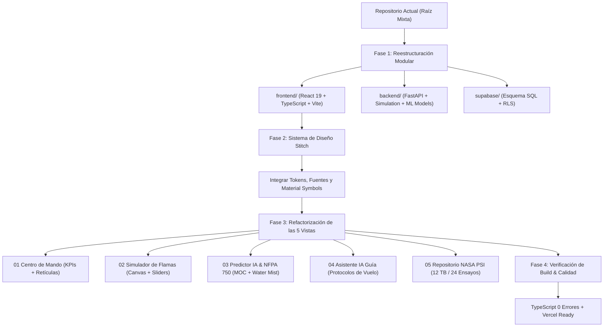

# 🚀 Plan de Implementación: Reestructuración Modular y Rediseño Visual Avanzado
## *Flame in Freefall // NASA Microgravity Combustion Safety Console*

---

## 1. Diagnóstico del Repositorio y Resolución de Dudas Arquitectónicas

### ¿Es necesaria la carpeta `simulation/`?
* **En el Frontend Web (Navegador/Vite/Vercel):**
  **No directamente.** El navegador ejecuta TypeScript/JavaScript, no scripts de Python. Toda la cinemática de combustión microgravitatoria (propagación $V_f$, desplazamiento del límite de oxígeno $\Delta LOI$, regímenes de llamas frías LTC por cinética de baja temperatura, y ecuaciones de agua nebulizada NFPA 750) ya ha sido portada con fidelidad matemática al motor TypeScript de alta velocidad en `src/physics/flameKinetics.ts`.
* **En el Ecosistema Integral (Backend Científico / Validación):**
  **¡Sí, es indispensable!**
  1. `simulation/flame_kinetics.py` constituye el **Gold Standard de validación física** en Python (usando SciPy y NumPy) contra el cual se contrastan los datos empíricos de NASA PSI y las aproximaciones analíticas.
  2. Genera los conjuntos de datos sintéticos y de Monte Carlo para entrenar los modelos de Machine Learning (`ml/data_generator.py`).
  3. Produce curvas gráficas de referencia (`outputs/cool_flame_transient.png`, `outputs/flame_spread_curves.png`).
* **Decisión:** **Conservar `simulation/` y reubicarla dentro de `backend/simulation/`**.

---

### ¿Qué ocurre con `ml/` y `app/`?
* **Carpeta `ml/`:**
  - Contiene los modelos entrenados en Scikit-Learn (`.joblib`), que superan los **130 MB** (ej. `flame_spread_model.joblib` de 86.2 MB), así como los scripts de entrenamiento (`train_all.py`, `flame_predictor.py`, `recommendation_engine.py`).
  - **Decisión:** Se reubica en `backend/ml/`. Los binarios pesados de Python jamás deben cargarse en el bundle del cliente web. Para el frontend creamos el motor ligero `src/physics/mlInference.ts`, mientras que el backend Python ofrece inferencia profunda mediante endpoints REST de FastAPI.
* **Carpeta `app/`:**
  - Contiene el prototipo inicial en Streamlit (`app.py`, `pages_backup/`, etc.).
  - **Decisión:** El código de interfaz Streamlit queda **obsoleto** y se retira o archiva, ya que el usuario requirió una aplicación web moderna, modular y mobile-first con React 19 + TypeScript.
  - **Dato Crítico a Preservar:** La subcarpeta `app/data/` (`materials_flammability.json`, `knowledge_base.json`, `psi_investigations.json`) contiene registros científicos invaluables de la NASA (LOI terrestre vs microgravedad, conductividad térmica, calor de combustión, expedientes BASS/SoFIE). Estos datos se consolidan tanto en `frontend/src/data/` como en `backend/data/` y en el esquema de Supabase.

---

### Estructura de Directorios Objetivo (Clean Architecture)

```
Nasa Internacional/
│
├── frontend/                                # App Web React 19 + TypeScript + Vite + Tailwind
│   ├── public/                              # Favicons, manifests e iconos de misión
│   ├── src/
│   │   ├── components/                      # Módulos UI aislados con ErrorBoundary
│   │   │   ├── Navbar.tsx                   # Avionics Header de 2 niveles + reloj UTC/MET + ECLSS
│   │   │   ├── ModuleErrorBoundary.tsx      # Aislamiento de fallos por subsistema
│   │   │   └── common/                      # Botones de 52px, retículas, chips de estado LED
│   │   ├── views/                           # 5 Vistas de operación idénticas al diseño Stitch:
│   │   │   ├── MissionDashboard.tsx         # 01 Centro de Mando
│   │   │   ├── FlameSimulator.tsx           # 02 Simulador de Flamas
│   │   │   ├── RiskPredictor.tsx            # 03 Predictor IA & NFPA 750
│   │   │   ├── AIAssistant.tsx              # 04 Asistente IA Guía
│   │   │   └── PSIRepository.tsx            # 05 Repositorio NASA PSI
│   │   ├── physics/                         # Motor físico en TypeScript (latencia cero)
│   │   │   ├── flameKinetics.ts             # Ecuaciones microgravedad (Fernandez-Pello, LTC, NFPA 750)
│   │   │   └── mlInference.ts               # Inferencia de riesgo y evaluación de límites
│   │   ├── lib/                             # Conectividad y persistencia
│   │   │   └── supabaseClient.ts            # Cliente Supabase con fallback offline (localStorage)
│   │   ├── types/                           # Tipado estricto TS (Material, Telemetry, Investigation)
│   │   └── data/                            # Datasets NASA (materiales, investigaciones, guías)
│   ├── index.html                           # Google Fonts (Space Grotesk, JetBrains Mono, Inter, Material Symbols)
│   ├── package.json
│   ├── tsconfig.json
│   ├── vite.config.ts
│   └── vercel.json                          # Configuración SPA lista para despliegue
│
├── backend/                                 # Servicio Científico & Machine Learning en Python
│   ├── api/                                 # Servidor FastAPI
│   │   └── main.py                          # Endpoints REST: /predict, /simulate-trajectory, /export-report
│   ├── simulation/                          # Modelos físicos analíticos y EDPs
│   │   ├── flame_kinetics.py                # Dinámica de llamas frías y propagación
│   │   └── outputs/                         # Gráficos y diagnósticos científicos
│   ├── ml/                                  # Pipeline de Scikit-Learn
│   │   ├── models/                          # Pesos de modelos .joblib
│   │   ├── data/                            # CSVs de telemetría y entrenamiento
│   │   └── train_all.py                     # Script de reentrenamiento
│   ├── data/                                # Archivos maestros JSON
│   └── requirements.txt                     # Dependencias (fastapi, uvicorn, scipy, scikit-learn, etc.)
│
├── supabase/                                # Esquema de Base de Datos y Políticas
│   └── schema.sql                           # Tablas PostgreSQL, RLS y función de auditoría
│
└── diseño interfaz/                         # Activos y guía de diseño oficial de Stitch
    ├── orbital_telemetry_precision/DESIGN.md # Especificación del Sistema de Diseño
    ├── centro_de_mando_flame_in_freefall/   # Export HTML y mockups
    ├── simulador_de_flamas_flame_in_freefall/
    ├── predictor_ia_y_nfpa_750_flame_in_freefall/
    ├── asistente_ia_gu_a_flame_in_freefall/
    └── repositorio_nasa_psi_flame_in_freefall/
```

---

## 2. Implementación del Sistema de Diseño *"Orbital Telemetry Precision"*

El diseño extraído de la carpeta `diseño interfaz` sigue el estándar de aviónica moderna de la ISS y SpaceX Dragon, enfocado en **cero fatiga visual** en cuartos oscuros de control de misión:

### A. Tipografía Arquitectónica Tri-Familia
1. **`Space Grotesk` (Encabezados y Jerarquía Estructural):** Geométrico, de alta legibilidad espacial.
   - `headline-xl`: 32px / 40px line-height, bold.
   - `headline-lg`: 24px / 32px line-height, semi-bold.
   - `headline-md`: 18px / 24px line-height, semi-bold.
2. **`Inter` (Cuerpo, Instrucciones y Bitácoras):** Máxima legibilidad neutral en pantallas móviles y monitores táctiles.
   - `body-lg`: 16px / 24px.
   - `body-md`: 14px / 20px.
3. **`JetBrains Mono` (Telemetría Numérica y Micro-etiquetas):** Números tabulares alineados que impiden saltos visuales en actualizaciones continuas.
   - `telemetry-data-lg`: 20px / 26px, mono tabular.
   - `telemetry-data-md`: 14px / 18px.
   - `label-caps`: 11px, tracking 0.08em (ej. `[ ⚡ EVALUAR RIESGO CON IA ]`).
   - `label-sm`: 10px, tracking 0.05em.

### B. Paleta Cromática y Ergonomía Visual
* **Fondo Base del Espacio:** `#0f131d` (Vacío profundo, previene fatiga ocular nocturna).
* **Superficies Translúcidas (Glassmorphism Técnico):**
  - Contenedor bajo: `rgba(24, 27, 37, 0.75)` con `backdrop-blur-md`
  - Contenedor medio: `rgba(28, 31, 41, 0.85)`
  - Borde reticular: `#1e293b` y `#334155`
* **Canales de Estado Funcional:**
  - **Primario (Cian Telemetría):** `#8ed5ff` / `#38bdf8` (Indicador activo, vectores de flujo).
  - **Secundario (Esmeralda Nominal):** `#4edea3` / `#10b981` (Condiciones seguras, enlace confirmado).
  - **Terciario (Ámbar Advertencia):** `#ffc174` / `#f59e0b` (Llamas frías LTC, umbral crítico de velocidad 1-3 cm/s).
  - **Alerta Crítica (Fuego Espacial):** `#ffb4ab` / `#93000a` / `#f43f5e` (Límite MOC violado, aborto térmico).

### C. Botones e Interactividad Táctil de Alta Confiabilidad
* **Dimensiones generosas:** Altura mínima de **52px** (`h-[52px]`) en escritorio y **48px** en pantallas móviles táctiles, con separación generosa (`gap-4` / `gap-space-md`), eliminando toques accidentales.
* **Micro-interacción táctil:** Animación `active:scale-[0.98]` con sombras de brillo reactivo (`shadow-[0_0_24px_rgba(56,189,248,0.35)]`).
* **Botones de Emergencia/Armado:** Patrón con doble estado para supresión NFPA 750 (Estado 1: "ARM" con textura ámbar; Estado 2: "DISCHARGE/FIRE" rojo pulsante).

### D. Navegación Intuitiva de Doble Nivel (`Navbar`)
* **Nivel 1 (Avionics Status Bar):**
  - Identidad de misión: Ícono de llama reactiva `local_fire_department`, versión `v4.2-AVX`, override `NASA-STD-6001B`.
  - Telemetría de tiempo: Reloj UTC en tiempo real milimétrico (`UTC 14:28:09.412`) y Tiempo Transcurrido de Misión (`MET +184:12:05:19`).
  - Selector de Atmósfera de Cabina: Switch rápido entre **ISS Nominal (21.0% O2, 1.0 atm)** y **Artemis Gateway (34.0% O2, 8.2 psia)**.
  - Indicador de estado de tripulante y comunicaciones en vivo.
* **Nivel 2 (Pestañas de Operación Orbital):**
  - Pestañas con numeración táctica: `01 CENTRO DE MANDO`, `02 SIMULADOR DE FLAMAS`, `03 PREDICTOR IA & NFPA 750`, `04 ASISTENTE IA GUÍA`, `05 REPOSITORIO NASA PSI`.
  - Indicador de pestaña activa con borde inferior cian `shadow-[inset_0_-2px_0_0_#38bdf8]` y fondo elevado.
  - Botón de acción rápida: `[ ⚠️ SIMULACIÓN DE CONTINGENCIA ]`.

---

## 3. Plan Detallado de Implementación por Vista



### Detalle de Componentes a Refactorizar:

| Vista | Módulo | Mejoras según la Carpeta `diseño interfaz` |
| :--- | :--- | :--- |
| **Navbar** | `Navbar.tsx` | Doble barra avionics, UTC/MET ticker en vivo, selector ISS/Artemis, tabs con estilo táctil y botón de simulación de contingencia. |
| **01 Centro de Mando** | `MissionDashboard.tsx` | Hero banner con acentos de gradiente atmosférico, botones táctiles de 52px, grid de 4 KPIs con mini-sparklines y badges de estado, matriz de riesgo de materiales BASS-II/SoFIE y feed de telemetría de vuelo en tiempo real. |
| **02 Simulador de Flamas** | `FlameSimulator.tsx` | Consola aerodinámica con canvas interactivo de llama esférica y transición a llama estirada, controles de flujo de aire (0 a 10 cm/s), concentración de oxígeno y presión, modo llama fría (LTC), y visor HUD de retículas. |
| **03 Predictor IA & NFPA 750** | `RiskPredictor.tsx` | Selector de materiales aeroespaciales, cálculo de desplazamiento de LOI ($\Delta LOI = -4.2\%$), concentración máxima de oxígeno (MOC), y calculadora de sistema de agua nebulizada NFPA 750 (flujo en L/min, boquilla de niebla y aditivo F-500). |
| **04 Asistente IA Guía** | `AIAssistant.tsx` | Terminal con árbol de decisiones de contingencia, modo de lenguaje dual (técnico para especialistas / simplificado para astronautas bajo estrés), presets de consultas y checklist de mitigación. |
| **05 Repositorio NASA PSI** | `PSIRepository.tsx` | Explorador interactivo de las 24 investigaciones de microgravedad (~12 TB: SoFIE, BASS, Saffire, ACME, CIR, FLEX), tabla con filtros por módulo de vuelo, buscador en tiempo real y descarga de tarjetas técnicas. |

---

## 4. Fases de Ejecución

1. **Paso 1: Organización de Archivos en `frontend/` y `backend/`**
   - Mover el código de la app web a la carpeta `frontend/`.
   - Crear la carpeta `backend/` y reubicar en ella `simulation/`, `ml/` y crear `backend/api/main.py`.
   - Limpiar el código legacy de Streamlit conservando los archivos JSON en `data/`.
2. **Paso 2: Configuración de Tokens e Iconos en `frontend/`**
   - Configurar `index.html` con las fuentes oficiales `Space Grotesk`, `Inter`, `JetBrains Mono` y Google `Material Symbols Outlined`.
   - Extender la configuración de Tailwind con los colores y espaciados de `orbital_telemetry_precision/DESIGN.md`.
3. **Paso 3: Implementación de Vistas y Componentes React**
   - Actualizar `Navbar.tsx`, `MissionDashboard.tsx`, `FlameSimulator.tsx`, `RiskPredictor.tsx`, `AIAssistant.tsx` y `PSIRepository.tsx` adaptando el HTML exacto de la carpeta `diseño interfaz` a componentes tipados en React 19.
4. **Paso 4: Verificación Integral**
   - Compilación estricta con `npx tsc --noEmit`.
   - Bundle para producción con `npm run build`.
   - Comprobación de carga y diseño visual.
